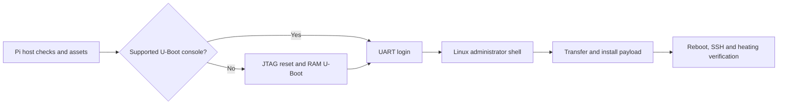

# ToonRooter application reference

Status checked against commit `d2d2b4e` on 2026-10-31. Start with
[RPI_INSTALL.md](RPI_INSTALL.md), then follow [TODO_MANUALLY.md](TODO_MANUALLY.md).

## Purpose and components

Rooting gives the Toon administrator access, including an SSH login for local
maintenance. It does **not** activate an unactivated thermostat. The current Python 3
application prepares and rehearses the procedure; it cannot yet root a real Toon.

- **UART** is a serial text connection to the Toon's console, at 115200 baud, 8N1
  (eight data bits, no parity, one stop bit).
- **JTAG** is a processor debug connection. It can stop/reset the CPU and change
  memory, interrupting normal thermostat operation.
- **OpenOCD** runs on the Pi and translates debugger commands into JTAG signals.
- **U-Boot** runs on the Toon before Linux. A supported console can change how Linux
  starts; otherwise the historical method loads another U-Boot into RAM through JTAG.

Python, OpenOCD, key generation and packaging run on the **Pi**. U-Boot, Linux,
Dropbear (an SSH server) and the installation script run on the **Toon**. Simulation
models those target components in Pi/development-machine memory and executes no scripts.



This is the intended target path. Beyond host preparation, it is currently a
simulation; only explicit receive-only UART observation can contact hardware.

## Intended sequence and effects

| Step | Effect on real Toon | Current implementation |
|---|---|---|
| Inspect Pi, keys, files and configuration | None | Host-only commands work |
| Confirm wiring/voltage, observe existing UART output | Observation; opening adapters may glitch control lines | `observe` implemented; physical setup untested |
| Use supported existing U-Boot console where possible | Sends console input | Protocol tested in simulation; no live workflow |
| Otherwise identify/init JTAG, halt/reset and load U-Boot at `0xa1f00000` | Changes CPU/registers/RAM and boot state | Reference chain reviewed; live JTAG disabled |
| Inspect environment, append `init=/bin/sh` to `addmisc`, run `boot_nand` | Temporary boot change; normal services bypassed | Constructed/tested in simulation; no `saveenv` |
| Transfer and install payload | Filesystem/package/configuration writes | Preparation works; transfer/execution simulation only |
| Reboot and check SSH, touchscreen and heating | Returns to normal operation if successful | Synthetic verification only |

The historical payload changes the root password, authorized keys, firewall,
VPN startup and installed SSH/SFTP packages. It has non-atomic edits and weak error
handling; it is not automatically approved for deployment. Loading code into RAM
also does not prove that executing it cannot write persistent storage.

## Main modules

| Module | Responsibility |
|---|---|
| `cli.py`, `config.py`, `deployment.py`, `diagnostics.py` | Arguments, host checks, environment reports, UART observation |
| `security/ssh_keys.py` | RSA creation/reuse, validation and exclusive file creation |
| `hardware/serial.py` | Bounded bytes-only I/O, partial writes, receive-only enforcement, cleanup |
| `hardware/openocd.py`, `hardware/config_review.py` | Fixed host queries/process cleanup; pinned source comparison |
| `boot/uboot.py`, `boot/compatibility.py` | Version/prompt parsing, environment inspection, binary analysis and route planning |
| `boot/sequence.py` | Earlier isolated boot-state simulation |
| `assets.py`, `data/` | Asset identity manifest and reviewed OpenOCD 0.12.0 reference |
| `payload.py`, `legacy_wire.py` | Host archive verification and historical gzip/base64 conversion |
| `workflow.py`, `testing/rooting.py` | Integrated source-derived rooting simulation |
| `transfer.py` | Separate synthetic `TRSIM1` experiment; not the Toon receiver |

Legacy `rooter.py`, `sshkeys.py`, `assets/` and `payload/` are reference material.
The modern entry point never imports legacy orchestration. Unlike the original,
it separates transport/protocol/operations, uses deadlines and bounded buffers,
validates keys, stops failed workflows, and keeps live installation disabled.

## CLI reference

Run from the checkout after installation. Examples use `.venv/bin/toonrooter`;
`python -m toonrooter` works with the corresponding environment too.

| Command | Scope and behavior |
|---|---|
| `doctor` | Host-only JSON checks; fixed OpenOCD version/adapter queries, no adapter initialization |
| `probe` | Host-only capability message; does not actually identify a Toon |
| `asset-audit` | Host-only hashes, bootloader analysis and optional installed-script comparison |
| `keys` | Local RSA key preparation/validation; never silently overwrites a private key |
| `package-payload` | Local files only; no transmission, extraction or execution |
| `simulate-root` | In-memory end-to-end rehearsal; all hardware/SSH observations synthetic |
| `observe` | **Hardware-capable**, receive-only UART open; finite capture, no software writes |

```sh
.venv/bin/toonrooter --help
.venv/bin/toonrooter doctor --repository . --serial-port /dev/serial0
.venv/bin/toonrooter probe
.venv/bin/toonrooter asset-audit --repository .
.venv/bin/toonrooter asset-audit --repository . --openocd-scripts /usr/share/openocd/scripts
.venv/bin/toonrooter keys --private-key ./id_rsa --encrypt
.venv/bin/toonrooter keys --ssh-public-key ./id_rsa.pub
.venv/bin/toonrooter package-payload --repository . --ssh-public-key ./id_rsa.pub --output ./payload.tar
.venv/bin/toonrooter package-payload --repository . --ssh-public-key ./id_rsa.pub --format legacy-base64 --output ./payload.b64
.venv/bin/toonrooter simulate-root --repository . --ssh-public-key ./id_rsa.pub --authorize-simulated-install --authorize-simulated-reboot
```

Key creation prompts privately for a passphrase. The external-public-key form validates
only that public key, not possession of its matching private key. Archive output paths
must not already exist; choose another filename on repeat runs. Default format is
host USTAR with a manifest; `legacy-base64` produces gzip tar in 76-column base64,
as the original receiver expects. Neither proves target receipt.

Only after a reviewed physical connection and separate authorization:

```sh
.venv/bin/toonrooter observe --serial /dev/serial0 --timeout 30 --max-bytes 65536
```

It prints timestamped escaped bytes, possible U-Boot version and termination reason.
Silence is inconclusive if the Toon is already running. It does not reset it to get output.

`probe --jtag` deliberately exits 2 with a disabled explanation. `root`, `boot-console`,
`backup`, `restore`, `verify` and `configure-local` are not CLI commands yet.
Doctor exits 1 for failed host checks, 0 when its boolean/FAIL checks pass; UNKNOWN
and HARDWARE_REQUIRED may remain. Exit 2 indicates an application/input error and
130 an interruption. No exit code certifies hardware readiness.

## Verified status and limits

The committed progress log records 135 tests on Python 3.13.12 and 3.14.8, including
local pseudo-terminal serial tests, plus Ruff, compilation, builds and installed-wheel
rehearsal. A pseudo-terminal is a local software serial pair, not a connected Toon.
CI includes Python 3.12–3.14; its remote results have not been established here.
See the latest entry in [PROGRESS](docs/PROGRESS.md) for this documentation session's run.

No physical Pi/Toon compatibility has been demonstrated. Missing pieces include a
live JTAG/boot backend, real response contracts, target transfer/staging validation,
reliable installation postconditions, backups/recovery and real SSH/heating checks.
The pinned target file overrides the adapter's reset policy; hashes prove file identity,
not safe initialization. Tar status zero is not an integrity check. There is no tested
universal rollback. Full details remain in the [architecture](docs/ROOTING_ARCHITECTURE.md),
[audit](docs/SECURITY_AUDIT.md) and [roadmap](docs/IMPLEMENTATION_PLAN.md).
